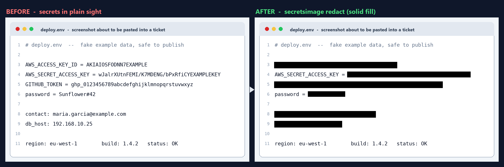

<p align="center">
  
</p>

<h1 align="center">secretsimage</h1>

<p align="center">
  Automatic, irreversible redaction of secrets and personal data in screenshots.
</p>

<p align="center">
  <a href="https://github.com/stescobedo92/secretsimage/actions/workflows/ci.yml"></a>
  <a href="https://github.com/stescobedo92/secretsimage/releases/latest"></a>
  <a href="LICENSE"></a>
  
</p>

Screenshots get pasted into Jira, Slack, Teams, Word documents and pull
requests with tokens, connection strings, e-mail addresses, internal IPs and
client names in plain sight. Secret scanners read text and code, not images,
so a credential inside a PNG passes without an alarm — and rotating a leaked
credential costs hours. `secretsimage` sits between the screenshot and the
paste: it OCRs the image, finds sensitive regions, covers them with a
**solid fill** (never blur, which is reversible), and writes an audit log of
what was covered. The audit log never contains the secret values themselves.

## Before / after



The left panel is a synthetic screenshot with fake example data (the AWS
documentation key, a sequential placeholder token, an `@example.com`
address). The right panel is the unedited output of
`secretsimage redact` on it: six findings — AWS key, high-entropy secret,
GitHub token, password, e-mail and private IP — covered with solid fill,
while clean text stays readable. A second `secretsimage scan` of the
redacted image finds nothing. Individual panels:
[before](docs/images/screenshot-before.png) ·
[after](docs/images/screenshot-after.png). Regenerate them with
`python tools/assets/generate_screenshots.py`.

## Download

Prebuilt binaries for **Windows (x86_64)**, **Linux (x86_64)** and
**macOS (arm64)** are published on the
[Releases page](https://github.com/stescobedo92/secretsimage/releases/latest)
with SHA-256 checksums. Releases follow
[Semantic Versioning](https://semver.org/): pushing a `vMAJOR.MINOR.PATCH`
tag that matches `CMakeLists.txt` and `CHANGELOG.md` builds, tests and
publishes all three platforms. Every other commit is built and tested by
CI on the same three OSes, and the binaries are kept as run artifacts.

The only runtime dependency is
[Tesseract OCR](https://tesseract-ocr.github.io/)
(`apt install tesseract-ocr`, `brew install tesseract`,
`choco install tesseract`).

## Modes

| Mode | What it does |
|---|---|
| `secretsimage watch` | Clipboard interception daemon. Every new clipboard image is redacted *before* you paste it — into a terminal, Word, Excel, PowerPoint, Teams, Slack, a browser showing Jira, or anything else. The foreground application is recorded in the audit log. |
| `secretsimage redact in.png -o out.png` | File mode for attachments and documentation images. Writes the redacted image plus `out.png.audit.json`. |
| `secretsimage scan img...` | Detection only. Exit code 2 when secrets are present, for CI gates over documentation images. |

Exit codes: `0` ok/clean, `1` error, `2` secrets found (`scan`, or
`redact --fail-on-secret`).

## What gets redacted

AWS/GCP keys, GitHub and Slack tokens, JWTs, bearer tokens, private-key
headers, URI and ADO.NET/Azure connection strings, labelled assignments
(`password = ...`, `api_key: ...`, including `=` misread by OCR as `-`),
e-mail addresses, private IPv4 addresses (RFC 1918, loopback, link-local,
CGNAT), IPv6, credit-card numbers (Luhn-checked), IBANs (mod-97 checked),
US SSNs, and generic high-entropy tokens. Look-alikes such as git SHAs,
UUIDs, times and version numbers are deliberately left alone; see
[docs/ARCHITECTURE.md](docs/ARCHITECTURE.md).

## Quick start

Prerequisites: a C++23 compiler, CMake 3.20+, and
[Tesseract OCR](https://tesseract-ocr.github.io/)
(`apt install tesseract-ocr`, `brew install tesseract`, or
`choco install tesseract`). It is found on `PATH` or in the standard
installer locations (e.g. `C:\Program Files\Tesseract-OCR`); set
`SECRETSIMAGE_TESSERACT` for custom installs. On Linux, clipboard watch mode additionally
needs X11 headers at build time (`libx11-dev`).

```sh
cmake -S . -B build -DCMAKE_BUILD_TYPE=Release
cmake --build build -j
ctest --test-dir build -L unit      # hermetic test suite + metrics
ctest --test-dir build -L ocr       # end-to-end with real Tesseract

build/secretsimage watch                       # start intercepting
build/secretsimage redact shot.png -o shot.redacted.png
build/secretsimage scan docs/images/*.png      # CI gate
```

## Measured results

From the reproducible test plan (see [docs/TEST_PLAN.md](docs/TEST_PLAN.md)),
on the synthetic corpus of 60 secret + 20 clean screenshots:

| Metric | Target | Measured |
|---|---|---|
| Secret recall (ground-truth OCR) | — | 120/120 (100%) |
| Token/key recall (ground-truth OCR) | ≥ 99% | 76/76 (100%) |
| Residual secrets after redaction (real OCR re-scan) | 0 | 0 (32/32 secrets fully covered, Tesseract 5.5) |
| Over-redaction of clean words | ≤ 5% | 0/3774 (0%) |
| Pipeline latency p95 (excl. OCR) | ≤ 2 s | ~0.6 ms per image |

## Documentation

- [Usage guide](docs/USAGE.md) — installation, watch mode per OS, CI recipes.
- [Architecture](docs/ARCHITECTURE.md) — how interception, detection and
  redaction fit together, and the failure policy.
- [Test plan](docs/TEST_PLAN.md) — the human review protocol (PR-3), the
  automated matrix (PR-4), and metric definitions.
- [Security policy](SECURITY.md) — scope, limitations and how to report issues.

## License

GPL-3.0. See [LICENSE](LICENSE). Vendored third-party components keep their
own licenses; see [third_party/README.md](third_party/README.md).
